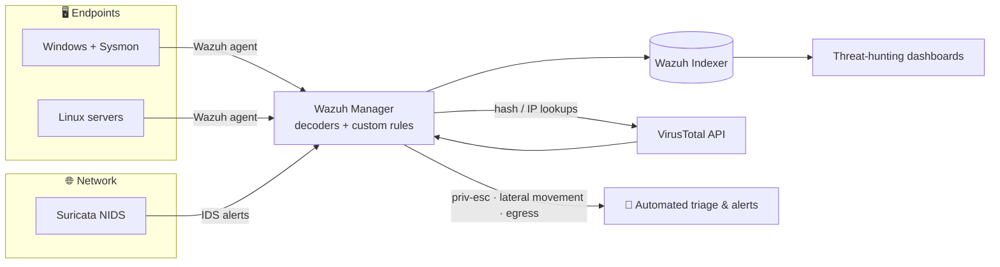
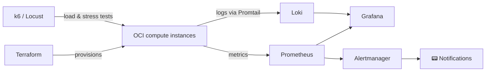
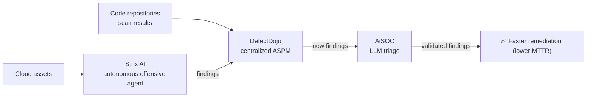

<!-- ───────────────────────────── HERO ───────────────────────────── -->
<a href="https://tanim.my.id">
  <picture>
    <source media="(prefers-color-scheme: dark)" srcset="./assets/hero-dark.svg">
    
  </picture>
</a>

<p align="center">
  <a href="https://tanim.my.id"></a>
  <a href="https://linkedin.com/in/contacttasnimrahmantanim"></a>
  <a href="mailto:mail.tasnimrahman@gmail.com"></a>
  <a href="./Tasnim_Rahman_Tanim_Resume.pdf"></a>
</p>

```yaml
# ~/.profile
name:        Tasnim Rahman Tanim
role:        Lead Solutions Architect & Security Auditor @ Goinnovior Limited
also:        Cybersecurity & Networking Trainer @ Skill Jobs
based_in:    Dhaka, Bangladesh 🇧🇩
credential:  ISO/IEC 27001:2022 Lead Auditor
clouds:      [Oracle Cloud (OCI), AWS, Microsoft Azure]
frameworks:  [ISO 27001, NIST CSF, SOC 2, GDPR]
building:    [SIEM/XDR pipelines, AI-assisted vuln triage, Odoo 19 ERP modules]
philosophy:  "Secure by design. Observable by default. Automated end to end."
```

<picture>
  <source media="(prefers-color-scheme: dark)" srcset="./assets/impact-dark.svg">
  
</picture>

## 🧭 What I do

I design and secure the infrastructure businesses run on — from multi-cloud landing zones and defense-in-depth security stacks to the CI/CD pipelines and applications on top. My edge is working across **all four layers** and translating compliance frameworks into systems that actually hold up in production.

<table>
<tr>
<td width="50%" valign="top">

### 🔐 Cybersecurity & GRC
Detection engineering, EDR/XDR rollouts, perimeter defense and audit-ready compliance.

- Production **Wazuh SIEM/XDR** with Sysmon, Suricata & VirusTotal enrichment
- Enterprise **EDR/XDR + NGFW** deployments with automated containment
- **ISO 27001 / NIST** audits of cloud workloads, endpoints & networks

`Wazuh` `Suricata` `Sysmon` `Kaspersky EDR/KATA` `Fortinet` `Sophos` `Defender for Endpoint` `Threat Hunting` `Incident Response` `ISO 27001` `NIST CSF` `SOC 2`

</td>
<td width="50%" valign="top">

### ☁️ Cloud & Infrastructure
Highly available multi-cloud architecture with identity at the core.

- **OCI, AWS & Azure** architectures delivering 99.9% uptime
- **Microsoft 365 / Entra ID** with conditional access & RBAC
- Network design: VLANs, site-to-site VPNs, enterprise Wi-Fi

`OCI` `AWS` `Azure` `Entra ID` `Intune` `Exchange` `Linux` `cPanel/WHM` `MikroTik` `WireGuard` `IPsec` `DNS / Mail`

</td>
</tr>
<tr>
<td width="50%" valign="top">

### ⚙️ DevOps, DevSecOps & SRE
Everything as code, everything observed, security in the pipeline.

- **Terraform** provisioning on OCI with full observability stack
- **Docker** + **GitHub Actions** CI/CD, removing release bottlenecks
- Load testing & tuning with **k6 / Locust** against SLOs

`Terraform` `Docker` `GitHub Actions` `Prometheus` `Grafana` `Loki` `Alertmanager` `k6` `Locust` `DefectDojo` `Container Security`

</td>
<td width="50%" valign="top">

### 💻 Software Development
Business software and web apps that ship to production.

- **Odoo 19 ERP** — 10+ custom modules (Payroll, Attendance, DMS…)
- In-browser document suite embedded in the ERP
- Modern web front-ends with **Next.js / React / TypeScript**

`Python` `PostgreSQL` `Odoo 19` `XML` `Next.js` `React` `TypeScript` `JavaScript` `REST APIs` `Bash` `PowerShell`

</td>
</tr>
</table>

<picture>
  <source media="(prefers-color-scheme: dark)" srcset="./assets/divider-dark.svg">
  
</picture>

## 🚀 Featured work

<table>
<tr>
<td width="50%" valign="top">

### 🛡️ Enterprise SIEM & SOC Telemetry
**Wazuh · Sysmon · Suricata · VirusTotal API**

Production Wazuh SIEM/XDR cluster with centralized log aggregation and custom threat-hunting dashboards. Automated triage rules for **privilege escalation, lateral movement and suspicious egress**, with hash/IP reputation lookups on every alert.

`Detection Engineering` `Threat Hunting` `NIDS`

</td>
<td width="50%" valign="top">

### 🤖 AI-Driven Vulnerability Management
**Strix AI · DefectDojo · AiSOC · LLM triage**

Unified DevSecOps pipeline: an autonomous offensive agent finds issues, DefectDojo de-duplicates and tracks them, and an LLM triage layer cuts false positives — **shrinking MTTR** across cloud assets and repos.

[**→ View repository**](https://github.com/TanimSec/AI-Driven-Vulnerability-Assessment-Management)

</td>
</tr>
<tr>
<td width="50%" valign="top">

### 📈 Multi-Cloud Observability Stack
**Terraform · OCI · Prometheus · Grafana · Loki · k6**

VPS fleet provisioned on Oracle Cloud with Terraform, wired into a full metrics + logs + alerting stack. Load-tested with k6 and Locust to tune kernel network parameters and resource quotas under high concurrency.

`IaC` `SRE` `Performance Engineering`

</td>
<td width="50%" valign="top">

### 🏢 Custom Enterprise ERP (Odoo 19)
**Python · PostgreSQL · XML · Odoo framework**

Co-engineered a production ERP with **10+ custom modules** — Payroll, Attendance, Time-off, Secure Document Management — plus a browser-native office suite. Strict RBAC, PostgreSQL indexing and automated off-site backups. Streamlined internal workflows by **30%**.

[**→ odoo.goinnovior.com**](https://odoo.goinnovior.com)

</td>
</tr>
</table>

<details open>
<summary><b>🧩 Architecture — SIEM &amp; detection pipeline</b></summary>
<br>



</details>

<details>
<summary><b>🧩 Architecture — Observability stack on OCI</b></summary>
<br>



</details>

<details>
<summary><b>🧩 Architecture — AI-driven vulnerability pipeline</b></summary>
<br>



</details>

## 💼 Experience

| When | Role | Highlights |
|---|---|---|
| **Jul 2024 – Present** | **Lead Solutions Architect & Security Auditor**<br>Goinnovior Limited | Multi-cloud & security architecture (OCI · AWS · Azure) at 99.9% uptime · Lead ISO 27001 / NIST auditor · EDR/XDR + NGFW rollouts · Dockerized services with GitHub Actions CI/CD · M365 governance with 96% client satisfaction · Executive presales demos driving a **15% higher win rate** |
| **Nov 2024 – Present** | **Cybersecurity & Networking Trainer**<br>Skill Jobs | 15+ four-month cohorts · **220+** professionals mentored · 95% completion · **60%** job placement into SOC, IT & network roles · Built real-world firewall, packet-analysis & incident-triage labs |
| **Jan 2023 – May 2023** | **Cybersecurity Engineering Intern**<br>Skylark Soft Limited | Security policy & compliance controls · Selected for the government-sponsored Cybersecurity Advancement Program (IIT & EDGE): threat intel, vuln scanning, digital forensics |

🎓 **B.Sc. in Information & Communication Engineering** — Daffodil International University (2023)

## 🏅 Certifications

> [!IMPORTANT]
> **ISO/IEC 27001:2022 Lead Auditor** — MasterMind (2026)

<table>
<tr>
<td width="33%" valign="top">

**🔐 Security**
- KATA & EDR Expert / Next EDR Admin — *Kaspersky* (2025)
- Google Cybersecurity Professional — *Google* (2023)
- Cybersecurity Specialization — *ICT Division & IIT, University of Dhaka* (2023)
- Defense Against the Digital Dark Arts — *Google* (2025)

</td>
<td width="33%" valign="top">

**🌐 Networks & Infrastructure**
- Connect and Protect: Networks & Network Security — *Google* (2025)
- Google IT Support Professional — *Google* (2023–24)
- Network & Server Administration — *Skill Jobs* (2023)

</td>
<td width="33%" valign="top">

**💻 Engineering**
- Full Stack Web Engineering — *Programming Hero* (2026)

</td>
</tr>
</table>

<details>
<summary><b>More training &amp; vendor credentials</b></summary>
<br>

- **Kaspersky:** Next EDR Optimum · MDR (Managed Detection & Response) · Security for Mail Server · Safe Web · SD-WAN · KUMA Sales & Presales
- **Security:** OPSWAT Cybersecurity Associate · OWASP CIIP · Password Hacking & Malware Security · Play It Safe: Manage Security Risks (Google)
- **Cloud & IT:** Microsoft 365 Administration · Azure Administration · Google Networking · Google OS & Systems Fundamentals · Meta MySQL · 21st Century Employability (ICT Division)

</details>

## 📊 Activity

<picture>
  <source media="(prefers-color-scheme: dark)" srcset="./dist/snake-dark.svg">
  
</picture>

---

<p align="center">
  <b>Open to</b> security architecture, cloud &amp; DevSecOps consulting, audits, and training engagements.<br>
  <a href="mailto:mail.tasnimrahman@gmail.com">mail.tasnimrahman@gmail.com</a> · <a href="https://tanim.my.id">tanim.my.id</a> · <a href="https://linkedin.com/in/contacttasnimrahmantanim">LinkedIn</a>
</p>

<p align="center"><sub><code>$ echo "Always learning. Always building. Always securing."</code></sub></p>
