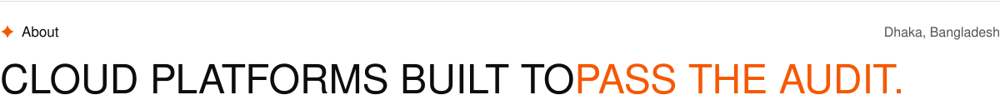
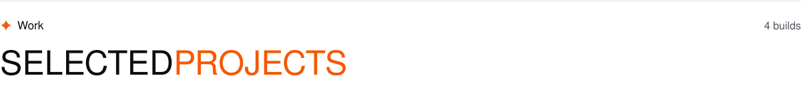
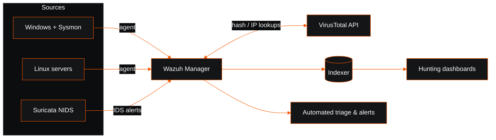
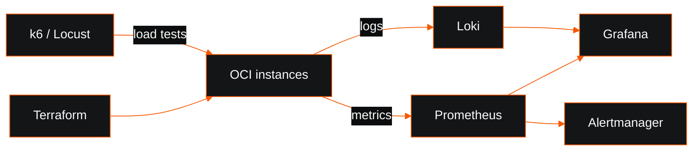
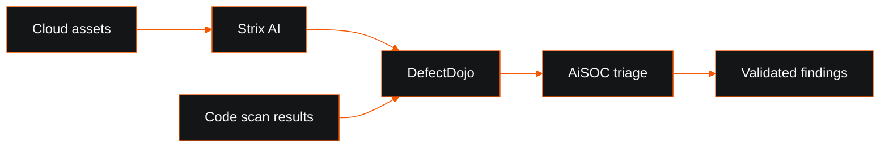

  &nbsp;
  &nbsp;
  &nbsp;
  

  

<picture>
  <source media="(prefers-color-scheme: dark)" srcset="./assets/h-about-dark.svg">
  
</picture>

Multi-cloud platforms on **OCI, AWS and Azure**, secured with **EDR and SIEM** and audited against **ISO 27001 and NIST**. Lead Solutions Architect at Goinnovior; cybersecurity and networking trainer at Skill Jobs.

 

<picture>
  <source media="(prefers-color-scheme: dark)" srcset="./assets/h-expertise-dark.svg">
  
</picture>

<table>
<tr>
<td width="50%" valign="top">

**01 — Cybersecurity & GRC**

Detection engineering, EDR/XDR rollouts, perimeter defense and audit-ready compliance.

WAZUH · SURICATA · SYSMON · KASPERSKY EDR · FORTINET · SOPHOS · ISO 27001 · NIST CSF · SOC 2

</td>
<td width="50%" valign="top">

**02 — Cloud & Infrastructure**

Highly available multi-cloud architecture with identity and access at the core.

OCI · AWS · AZURE · ENTRA ID · INTUNE · M365 · LINUX · MIKROTIK · WIREGUARD · IPSEC

</td>
</tr>
<tr>
<td width="50%" valign="top">

**03 — DevOps & Observability**

Infrastructure as code, containerized delivery and monitoring measured against SLOs.

TERRAFORM · DOCKER · GITHUB ACTIONS · PROMETHEUS · GRAFANA · LOKI · K6 · LOCUST

</td>
<td width="50%" valign="top">

**04 — Software Development**

Business systems and web apps that ship to production.

PYTHON · POSTGRESQL · ODOO 19 · NEXT.JS · REACT · TYPESCRIPT · REST APIS

</td>
</tr>
</table>

 

<picture>
  <source media="(prefers-color-scheme: dark)" srcset="./assets/h-work-dark.svg">
  
</picture>

<table>
<tr>
<td width="50%" valign="top">

**Enterprise SIEM & SOC Telemetry**

Production Wazuh SIEM/XDR cluster with Sysmon endpoint auditing, Suricata network detection and VirusTotal enrichment. Automated triage for privilege escalation, lateral movement and suspicious egress.

WAZUH · SYSMON · SURICATA · VIRUSTOTAL API

</td>
<td width="50%" valign="top">

**AI-Driven Vulnerability Management**

One DevSecOps pipeline: Strix AI finds issues, DefectDojo centralizes them and LLM triage removes false positives, cutting time to remediation.

STRIX AI · DEFECTDOJO · AISOC &nbsp;·&nbsp; [View repo ↗](https://github.com/TanimSec/AI-Driven-Vulnerability-Assessment-Management)

</td>
</tr>
<tr>
<td width="50%" valign="top">

**Multi-Cloud Observability Stack**

Oracle Cloud instances provisioned with Terraform, wired into metrics, logs and alerting, then load-tested with k6 and Locust to tune kernel and resource limits.

TERRAFORM · OCI · PROMETHEUS · GRAFANA · LOKI · ALERTMANAGER

</td>
<td width="50%" valign="top">

**Custom Enterprise ERP on Odoo 19**

10+ custom modules (Payroll, Attendance, Time-off, Document Management) and a browser-native office suite, with strict RBAC and automated off-site backups.

PYTHON · POSTGRESQL · ODOO 19 &nbsp;·&nbsp; [Visit ↗](https://odoo.goinnovior.com)

</td>
</tr>
</table>

<b>Architecture diagrams</b>

 

**SIEM & detection pipeline**

**Observability on OCI**

**AI vulnerability pipeline**

 

<picture>
  <source media="(prefers-color-scheme: dark)" srcset="./assets/h-career-dark.svg">
  
</picture>

**Lead Solutions Architect & Security Auditor** — Goinnovior Limited 
JUL 2024 — PRESENT 
Multi-cloud and security architecture on OCI, AWS and Azure at 99.9% uptime. Lead ISO 27001 / NIST auditor. EDR/XDR, NGFW and Odoo 19 ERP delivery, Docker + GitHub Actions CI/CD, and executive presales that lifted win rate by 15%.

**Cybersecurity & Networking Trainer** — Skill Jobs 
NOV 2024 — PRESENT 
15+ four-month cohorts and 220+ professionals trained, with 95% completion and 60% job placement into SOC, IT and network roles.

**Cybersecurity Engineering Intern** — Skylark Soft Limited 
JAN 2023 — MAY 2023 
Security policy and compliance controls. Selected for the government-sponsored Cybersecurity Advancement Program (IIT & EDGE).

EDUCATION — B.Sc. Information & Communication Engineering, Daffodil International University (2023)

 

<picture>
  <source media="(prefers-color-scheme: dark)" srcset="./assets/h-credentials-dark.svg">
  
</picture>

**ISO/IEC 27001:2022 Lead Auditor** — MasterMind, 2026

- KATA & EDR Expert · Next EDR Administration — Kaspersky, 2025
- Google Cybersecurity Professional Certificate — Google, 2023
- Cybersecurity Specialization — ICT Division & IIT, University of Dhaka, 2023
- Full Stack Web Engineering — Programming Hero, 2026

All certifications

 

- Google IT Support Professional Certificate — Google, 2023–24
- Connect and Protect: Networks and Network Security — Google, 2025
- IT Security: Defense Against the Digital Dark Arts — Google, 2025
- Network & Server Administration — Skill Jobs, 2023
- Kaspersky: Next EDR Optimum · MDR · Security for Mail Server · Safe Web · SD-WAN · KUMA Sales & Presales
- OPSWAT Cybersecurity Associate · OWASP CIIP · Password Hacking & Malware Security · Play It Safe: Manage Security Risks
- Microsoft 365 Administration · Azure Administration · Google Networking · Google OS & Systems Fundamentals · Meta MySQL

 

<picture>
  <source media="(prefers-color-scheme: dark)" srcset="./dist/snake-dark.svg">
  
</picture>

  

<picture>
  <source media="(prefers-color-scheme: dark)" srcset="./assets/h-contact-dark.svg">
  
</picture>

  &nbsp;
  

